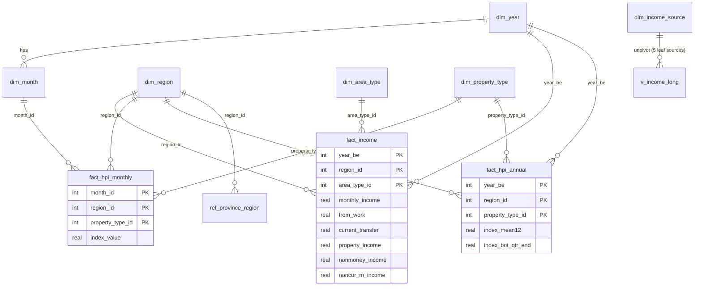

# 03 · ฐานข้อมูลเชิงสัมพันธ์ (RDB Schema)

โปรเจกต์: `income-housing-dashboard` · ไฟล์ฐานข้อมูล `data/dashboard.db` (SQLite 3.45) · DDL ฉบับเต็ม `sql/schema.sql` (อยู่ท้ายเอกสารนี้) · สร้างใหม่ทั้งหมดด้วย

```bash
python etl/build_db.py        # อ่าน data/raw/* -> data/dashboard.db + data/expected_values.json (มี self-test)
python etl/build_regions_geojson.py   # (ไม่บังคับ) สร้าง static/regions.geojson ใหม่
```

## 1. หลักการออกแบบ
1. **ตารางข้อเท็จจริง (fact) เก็บตามรูปแบบต้นทาง** `fact_income` เก็บแบบกว้างเหมือน CSV เพื่อให้ตรวจเทียบไฟล์ได้ ส่วนรูปแบบยาว (long) สำหรับ treemap อยู่ใน view `v_income_long`
2. **มิติร่วม `dim_region` ใช้รหัสเดียวกับ สสช. (`CODE_REGION` 0–5)** ถ้อยคำที่ต่างกันของแต่ละไฟล์เก็บเป็นคอลัมน์ `income_label_th`, `hpi_label_th` ไม่ใช้ชื่อเป็นคีย์
3. **ดัชนีรายปีเป็นตารางที่คำนวณแล้ว (`fact_hpi_annual`)** เพราะรายได้เป็นรายปี ส่วนรายเดือนเก็บไว้ให้กราฟแนวโน้มรายเดือน
4. **ดัชนีรายได้เป็น view (`v_income_index`)** ฐาน = ปีแรกของข้อมูล (2554 = 100) เหมือนฐานของดัชนีราคาบ้าน
5. **ไม่ interpolate** รายได้ปีที่ไม่มีรอบสำรวจ `v_price_to_income` จึงมีเฉพาะปีที่มีทั้งสองฝั่ง (8 ปี)
6. **CAGR และข้อความสรุปคำนวณในชั้น Python** (ไม่ใช้ `POWER()` ใน SQL เพื่อไม่ให้ผูกกับ SQLite รุ่นที่เปิดฟังก์ชันคณิตศาสตร์)

## 2. แผนภาพ ER



## 3. พจนานุกรมตาราง (จำนวนแถวที่ตรวจแล้ว)

| ตาราง | แถว | คีย์หลัก | หน้าที่ |
|---|---|---|---|
| `meta_dataset` | 2 | `dataset_id` | ทะเบียนชุดข้อมูล ที่มา หน่วย ฐานดัชนี หมายเหตุ (ใช้แสดง footnote ในหน้าเว็บ) |
| `dim_year` | 15 | `year_be` | ปี 2554–2568 พร้อมธง `has_income_survey`, `has_hpi` |
| `dim_month` | 180 | `month_id` (= ปี×100+เดือน เช่น 255401) | เดือน ไตรมาส ธง `is_quarter_end` |
| `dim_region` | 6 | `region_id` | 0 ทั่วประเทศ · 1 กทม.+ปริมณฑล · 2 กลาง · 3 เหนือ · 4 อีสาน · 5 ใต้ |
| `dim_area_type` | 3 | `area_type_id` | 0 รวม · 1 ในเขตเทศบาล · 2 นอกเขตเทศบาล |
| `dim_property_type` | 3 | `property_type_id` | 1 `ALL` · 2 `DETACHED` · 3 `TOWNHOUSE` |
| `dim_income_source` | 8 | `source_id` | 5 ใบ (`is_leaf=1`) + 3 ยอดรวม พร้อมกลุ่มสำหรับ treemap |
| `ref_province_region` | 76 | `province_en` | จับคู่จังหวัด → ภาค สำหรับสร้างรูปภาค |
| `fact_income` | 144 | `(year_be, region_id, area_type_id)` | รายได้ตามแหล่งที่มา (บาท/ครัวเรือน/เดือน) |
| `fact_hpi_monthly` | 2,880 | `(month_id, region_id, property_type_id)` | ดัชนีราคาที่อยู่อาศัยรายเดือน (2554=100) |
| `fact_hpi_annual` | 240 | `(year_be, region_id, property_type_id)` | ดัชนีรายปี 2 วิธี (`index_mean12` เป็นค่าเริ่มต้น) |

**View**

| View | กราฟที่ใช้ | คอลัมน์สำคัญ |
|---|---|---|
| `v_income_long` | Tab 1 treemap | `source_name_th`, `group_th`, `amount_baht`, `monthly_income` |
| `v_income_index` | Tab 1 แนวโน้ม, Tab 3 | `income_index` (ฐานปี 2554) |
| `v_income_urban_rural_gap` | Tab 1 heat map | `gap_pct` = (ในเขต−นอกเขต)÷นอกเขต×100 |
| `v_hpi_yoy` | Tab 2 heat map / แผนที่ | `yoy_pct` (ปี 2554 เป็น NULL) |
| `v_price_to_income` | Tab 3 เส้นอัตราส่วน/แท่งคู่ | `income_index`, `hpi_index`, `price_to_income_index` (128 แถว) |

## 4. สูตร (ตัวชี้วัดที่ทุก endpoint ต้องใช้ตรงกัน)

| ตัวชี้วัด | สูตร | หมายเหตุ |
|---|---|---|
| ดัชนีรายได้ | `100 × รายได้(ปี t) ÷ รายได้(2554)` | ภาคเดียวกัน ประเภทเขตเดียวกัน (Tab 3 ใช้ `area_type_id=0`) |
| ดัชนีราคาบ้านรายปี | `fact_hpi_annual.index_mean12` | เฉลี่ย 12 เดือน (2554 ≈ 100.0) |
| YoY (%) | `100 × (ดัชนีปี t ÷ ดัชนีปี t−1 − 1)` | |
| CAGR (%) | `100 × ((ค่าปลายช่วง ÷ ค่าต้นช่วง)^(1 ÷ (ปีปลาย − ปีต้น)) − 1)` | ใช้ **ค่ารายได้ (บาท)** หรือ **ดัชนี** ก็ได้ผลเท่ากัน เพราะเป็นอัตราส่วน |
| ดัชนีราคา ÷ รายได้ (เส้นอัตราส่วน) | `100 × (HPI_t ÷ HPI_ต้นช่วง) ÷ (Inc_t ÷ Inc_ต้นช่วง)` | **rebase ที่ต้นช่วงที่ผู้ใช้เลือก** เส้นเริ่มที่ 100 เสมอ ถ้าต้นช่วง = 2554 ได้ค่าเท่ากับ `v_price_to_income.price_to_income_index` (view rebase ดัชนีราคาบ้านให้ปี 2554 = 100 พอดี) |
| ความหมาย | ค่ามากกว่า 100 = ราคาบ้านโตเร็วกว่ารายได้นับจากต้นช่วง → **ซื้อยากขึ้น** · น้อยกว่า 100 = ง่ายขึ้น | ไม่ใช่จำนวนปีของรายได้ที่ต้องใช้ซื้อบ้าน (ไม่มีราคาเป็นบาท) |
| ช่องว่าง CAGR | `CAGR ราคาบ้าน − CAGR รายได้` (จุดเปอร์เซ็นต์) | แสดงเป็นตัวเลขหลักของ Tab 3 |

ตัวอย่างโค้ดอ้างอิง

```python
def cagr(v0: float, v1: float, years: int) -> float:
    return (v1 / v0) ** (1.0 / years) - 1.0          # ปีปลาย > ปีต้น เสมอ; ถ้า years == 0 ให้คืน None

def price_to_income(hpi: dict, inc: dict, years: list[int]) -> dict:
    y0 = years[0]
    return {y: 100 * (hpi[y] / hpi[y0]) / (inc[y] / inc[y0]) for y in years}
```

## 5. สูตรค้นข้อมูลต่อกราฟ (ทดสอบรันแล้วกับ `dashboard.db`)

พารามิเตอร์แบบ `:name` (SQLite) · `NULL` หมายถึงไม่กรอง · ทุก query ใส่ `ORDER BY r.map_order` เพื่อให้สีและอันดับภาคคงที่ทุกกราฟ

### Tab 1 — รายได้
```sql
-- 1A choropleth (ระดับรายได้) :year :area      [ตัวชี้วัดอื่น: v_income_index.income_index, 100*current_transfer/monthly_income]
SELECT r.region_id, r.short_th, f.monthly_income AS value
FROM fact_income f JOIN dim_region r ON r.region_id = f.region_id
WHERE f.year_be = :year AND f.area_type_id = :area AND r.region_id > 0
ORDER BY r.map_order;

-- 1B treemap :year :area :region(NULL = ทุกภาค)      -> 25 แถว (5 ภาค × 5 แหล่ง) หรือ 5 แถวถ้าเลือกภาค
SELECT r.short_th AS region, l.group_th, l.source_name_th, l.amount_baht,
       100.0 * l.amount_baht / l.monthly_income AS share_pct
FROM v_income_long l JOIN dim_region r ON r.region_id = l.region_id
WHERE l.year_be = :year AND l.area_type_id = :area AND r.region_id > 0
  AND (:region IS NULL OR l.region_id = :region);

-- 1C แนวโน้ม :area :y0 :y1      -> 6 พื้นที่ × 7 รอบ = 42 แถว (2554-2566)
SELECT f.year_be, r.short_th, f.monthly_income, i.income_index
FROM fact_income f
JOIN v_income_index i ON i.year_be = f.year_be AND i.region_id = f.region_id AND i.area_type_id = f.area_type_id
JOIN dim_region r ON r.region_id = f.region_id
WHERE f.area_type_id = :area AND f.year_be BETWEEN :y0 AND :y1
ORDER BY r.map_order, f.year_be;

-- 1D heat map (ช่องว่างเมือง-ชนบท) :y0 :y1      -> 42 แถว (ไม่ขึ้นกับตัวกรองเขต)
SELECT g.year_be, r.short_th, g.gap_pct
FROM v_income_urban_rural_gap g JOIN dim_region r ON r.region_id = g.region_id
WHERE g.year_be BETWEEN :y0 AND :y1 ORDER BY r.map_order, g.year_be;
```

### Tab 2 — ดัชนีราคาบ้าน
```sql
-- 2A choropleth (ดัชนีรายปี) :year :pt     -> 5 แถว (ทาวน์เฮ้าส์ pt=3 ได้ 3 แถว: ไม่มีเหนือ/อีสาน)
SELECT r.region_id, r.short_th, a.index_mean12 AS value
FROM fact_hpi_annual a JOIN dim_region r ON r.region_id = a.region_id
WHERE a.year_be = :year AND a.property_type_id = :pt AND r.region_id > 0
ORDER BY r.map_order;
-- ตัวชี้วัดอื่น: yoy -> v_hpi_yoy.yoy_pct · CAGR -> ดึง 2 ปี (ข้อ 3B) แล้วคำนวณใน Python

-- 2B แนวโน้มรายเดือน :pt :y0 :y1      -> 936 แถว (6 ภาค × 156 เดือน ช่วง 2554-2566)
SELECT m.month_id, m.year_be, m.month_no, r.short_th, f.index_value
FROM fact_hpi_monthly f
JOIN dim_month m ON m.month_id = f.month_id
JOIN dim_region r ON r.region_id = f.region_id
WHERE f.property_type_id = :pt AND m.year_be BETWEEN :y0 AND :y1
ORDER BY r.map_order, m.month_id;

-- 2C heat map (YoY ภาค × ปี) :pt :y0 :y1      -> 72 แถว
SELECT v.year_be, r.short_th, v.yoy_pct
FROM v_hpi_yoy v JOIN dim_region r ON r.region_id = v.region_id
WHERE v.property_type_id = :pt AND v.year_be BETWEEN :y0 AND :y1 AND v.yoy_pct IS NOT NULL
ORDER BY r.map_order, v.year_be;
```

### Tab 3 — เปรียบเทียบรายได้กับราคาบ้าน
```sql
-- 3A/3B เส้นอัตราส่วน + แท่งคู่ :pt :y0 :y1       -> ได้ income_index, hpi_index (rebase ปี 2554 = 100), price_to_income_index (ฐาน 2554)
SELECT p.year_be, r.short_th, p.income_index, p.hpi_index, p.price_to_income_index
FROM v_price_to_income p JOIN dim_region r ON r.region_id = p.region_id
WHERE p.property_type_id = :pt AND p.year_be BETWEEN :y0 AND :y1
ORDER BY r.map_order, p.year_be;
-- ถ้า :y0 > 2554 ให้ rebase ใน Python ตามสูตรในหัวข้อ 4 (ไม่ rebase ใน SQL)

-- 3C/3D CAGR: ดึงค่าต้น-ปลายช่วง แล้วคำนวณ CAGR ใน Python
SELECT r.code, r.short_th, s.monthly_income AS v0, e.monthly_income AS v1, e.year_be - s.year_be AS years
FROM fact_income s
JOIN fact_income e ON e.region_id = s.region_id AND e.area_type_id = s.area_type_id
JOIN dim_region r ON r.region_id = s.region_id
WHERE s.year_be = :y0 AND e.year_be = :y1 AND s.area_type_id = 0;

SELECT r.code, r.short_th, s.index_mean12 AS v0, e.index_mean12 AS v1, e.year_be - s.year_be AS years
FROM fact_hpi_annual s
JOIN fact_hpi_annual e ON e.region_id = s.region_id AND e.property_type_id = s.property_type_id
JOIN dim_region r ON r.region_id = s.region_id
WHERE s.year_be = :y0 AND e.year_be = :y1 AND s.property_type_id = :pt;
-- แยกตามประเภทบ้าน: ไม่ใส่ :pt แล้ว GROUP ตาม property_type_id โดยเลือก region_id = :region
```
ผลที่ต้องได้ (2554→2566): CAGR รายได้ทั้งประเทศ 1.87% · CAGR ราคาบ้านรวมทุกประเภท 4.40% · ดู `data/expected_values.json` สำหรับทุกภาค

## 6. ขั้นตอน ETL (สิ่งที่ `etl/build_db.py` ทำ)
1. สร้างฐานใหม่จาก `sql/schema.sql` แล้วใส่ข้อมูลมิติ (ภาค ประเภทเขต ประเภทบ้าน แหล่งรายได้ ปี เดือน)
2. อ่าน CSV รายได้ (`utf-8-sig`) → `fact_income` ใช้เฉพาะคอลัมน์รหัส ไม่ใช้ชื่อ `REGION`/`AREA`
3. อ่านชีต `Monthly` ด้วย `pandas.read_excel(header=None)`: หาแถวหัวตารางจากรูปแบบ "เดือนไทย ปี" · แถวที่ไม่มีตัวเลขคือหัวกลุ่มประเภทบ้าน · ตัดช่องว่างทุกชื่อภาคก่อนจับคู่ · หยุดที่แถวว่างหลังตาราง → `fact_hpi_monthly` (2,880 แถว)
4. คำนวณ `fact_hpi_annual` จากปีที่มีครบ 12 เดือนเท่านั้น (ทั้ง `mean12` และ `qtr_end`)
5. โหลด `ref_province_region` และ `meta_dataset`
6. **Self-test (ต้องผ่านทุกข้อ):** `integrity_check` และ `foreign_key_check` ว่าง · จำนวนแถวตามตารางข้างบน · ผลรวม 5 ส่วนรายได้คลาดจาก `monthly_income` ไม่เกิน 5 บาท (จริง 2) · `index_mean12` ปี 2554 อยู่ในช่วง 99.9–100.1 ทุก series · ภาคเหนือ/อีสาน ดัชนี `ALL` = `DETACHED` ครบ 180 เดือน · `v_price_to_income` = 128 แถว · `v_income_urban_rural_gap` = 48 แถว
7. เขียน `data/expected_values.json` เป็นค่าอ้างอิงให้ pytest ของแดชบอร์ด

### ข้อมูลใหม่ในอนาคต
- เพิ่มปีรายได้: ต่อไฟล์ CSV แล้วรัน ETL ใหม่ (`dim_year` ปรับเอง) · เพิ่มเดือนของ ธปท.: วางไฟล์ xlsx ใหม่ โครงสร้างเดิมต้องผ่าน assertion ถ้าไม่ผ่านให้ตรวจชื่อกลุ่มและชื่อภาค
- ย้ายไป PostgreSQL: `REAL` → `NUMERIC(12,2)` · คอลัมน์ธง 0/1 → `BOOLEAN` · ลบบรรทัด `PRAGMA` · view ใช้ได้ตามเดิม (`POWER()` ใช้ได้)

## 7. DDL ฉบับเต็ม (`sql/schema.sql`)

```sql
-- income-housing-dashboard : relational schema (SQLite 3; ANSI-style so it ports to PostgreSQL)
-- Years are Buddhist Era (พ.ศ.). Base year of every index = 2554 (=100).
-- Rebuild everything with:  python etl/build_db.py

PRAGMA foreign_keys = ON;

-- ============================================================
-- 0. Dataset registry (lineage)
-- ============================================================
CREATE TABLE meta_dataset (
    dataset_id        TEXT PRIMARY KEY,           -- 'income_ses' | 'hpi_bot'
    name_th           TEXT NOT NULL,
    source_org        TEXT NOT NULL,
    source_ref        TEXT,                       -- table/series code
    file_name         TEXT NOT NULL,
    frequency         TEXT NOT NULL,              -- 'biennial' | 'monthly'
    unit              TEXT NOT NULL,
    base_year_be      INTEGER,                    -- index base year, NULL for money values
    coverage_start_be INTEGER NOT NULL,
    coverage_end_be   INTEGER NOT NULL,
    notes             TEXT
);

-- ============================================================
-- 1. Dimensions
-- ============================================================
CREATE TABLE dim_year (
    year_be           INTEGER PRIMARY KEY,
    year_ce           INTEGER NOT NULL,
    has_income_survey INTEGER NOT NULL CHECK (has_income_survey IN (0,1)),
    has_hpi           INTEGER NOT NULL CHECK (has_hpi IN (0,1))
);

CREATE TABLE dim_month (
    month_id       INTEGER PRIMARY KEY,           -- year_be*100 + month_no, e.g. 255401
    year_be        INTEGER NOT NULL REFERENCES dim_year(year_be),
    month_no       INTEGER NOT NULL CHECK (month_no BETWEEN 1 AND 12),
    month_abbr_th  TEXT    NOT NULL,
    quarter_no     INTEGER NOT NULL CHECK (quarter_no BETWEEN 1 AND 4),
    is_quarter_end INTEGER NOT NULL CHECK (is_quarter_end IN (0,1)),
    UNIQUE (year_be, month_no)
);

-- One region list shared by both datasets. region_id = SES CODE_REGION.
CREATE TABLE dim_region (
    region_id       INTEGER PRIMARY KEY,          -- 0 national, 1 BMR, 2 central, 3 north, 4 north-east, 5 south
    code            TEXT NOT NULL UNIQUE,         -- TH BMR CEN NOR NES SOU
    name_th         TEXT NOT NULL,
    short_th        TEXT NOT NULL,
    name_en         TEXT NOT NULL,
    is_national     INTEGER NOT NULL CHECK (is_national IN (0,1)),
    income_label_th TEXT NOT NULL,                -- wording used in the SES file
    hpi_label_th    TEXT NOT NULL,                -- wording used in the BoT file
    map_order       INTEGER NOT NULL
);

CREATE TABLE dim_area_type (                      -- income dataset only
    area_type_id INTEGER PRIMARY KEY,             -- 0 total, 1 municipal, 2 non-municipal
    name_th      TEXT NOT NULL,
    name_en      TEXT NOT NULL
);

CREATE TABLE dim_property_type (                  -- house price dataset only
    property_type_id INTEGER PRIMARY KEY,
    code             TEXT NOT NULL UNIQUE,        -- ALL | DETACHED | TOWNHOUSE
    name_th          TEXT NOT NULL,
    name_en          TEXT NOT NULL
);

CREATE TABLE dim_income_source (                  -- leaf sources add up to monthly_income
    source_id  INTEGER PRIMARY KEY,
    code       TEXT NOT NULL UNIQUE,              -- column name in the SES file
    name_th    TEXT NOT NULL,
    group_th   TEXT NOT NULL,                     -- treemap parent
    is_leaf    INTEGER NOT NULL CHECK (is_leaf IN (0,1)),
    sort_order INTEGER NOT NULL
);

-- Map helper: province polygons -> region (for dissolving region shapes)
CREATE TABLE ref_province_region (
    province_en TEXT PRIMARY KEY,                 -- GeoJSON property "name"
    region_id   INTEGER NOT NULL REFERENCES dim_region(region_id)
);

-- ============================================================
-- 2. Facts
-- ============================================================
CREATE TABLE fact_income (                        -- baht / household / month, 8 survey waves
    year_be          INTEGER NOT NULL REFERENCES dim_year(year_be),
    region_id        INTEGER NOT NULL REFERENCES dim_region(region_id),
    area_type_id     INTEGER NOT NULL REFERENCES dim_area_type(area_type_id),
    monthly_income   REAL NOT NULL,               -- = current_income + noncur_m_income
    current_income   REAL NOT NULL,               -- = money_income + nonmoney_income
    money_income     REAL NOT NULL,               -- = from_work + current_transfer + property_income
    from_work        REAL NOT NULL,
    current_transfer REAL NOT NULL,
    property_income  REAL NOT NULL,
    nonmoney_income  REAL NOT NULL,
    noncur_m_income  REAL NOT NULL,
    PRIMARY KEY (year_be, region_id, area_type_id)
);

CREATE TABLE fact_hpi_monthly (                   -- index, 2554 = 100
    month_id         INTEGER NOT NULL REFERENCES dim_month(month_id),
    region_id        INTEGER NOT NULL REFERENCES dim_region(region_id),
    property_type_id INTEGER NOT NULL REFERENCES dim_property_type(property_type_id),
    index_value      REAL NOT NULL,
    PRIMARY KEY (month_id, region_id, property_type_id)
);

-- Derived by the ETL from fact_hpi_monthly (full years only)
CREATE TABLE fact_hpi_annual (
    year_be           INTEGER NOT NULL REFERENCES dim_year(year_be),
    region_id         INTEGER NOT NULL REFERENCES dim_region(region_id),
    property_type_id  INTEGER NOT NULL REFERENCES dim_property_type(property_type_id),
    index_mean12      REAL NOT NULL,              -- DEFAULT: average of the 12 monthly values (2554 = 100.0)
    index_bot_qtr_end REAL NOT NULL,              -- BoT footnote method: average of Mar/Jun/Sep/Dec values
    PRIMARY KEY (year_be, region_id, property_type_id)
);

CREATE INDEX ix_hpi_monthly_region ON fact_hpi_monthly(region_id, property_type_id);
CREATE INDEX ix_income_region      ON fact_income(region_id, area_type_id);

-- ============================================================
-- 3. Views (one per chart family)
-- ============================================================

-- Treemap: leaf income sources in long form with share of the row total
CREATE VIEW v_income_long AS
SELECT f.year_be, f.region_id, f.area_type_id,
       s.source_id, s.code AS source_code, s.name_th AS source_name_th, s.group_th,
       CASE s.code
            WHEN 'FROM_WORK'        THEN f.from_work
            WHEN 'CURRENT_TRANSFER' THEN f.current_transfer
            WHEN 'PROPERTY_INCOME'  THEN f.property_income
            WHEN 'NONMONEY_INCOME'  THEN f.nonmoney_income
            WHEN 'NONCUR_M_INCOME'  THEN f.noncur_m_income
       END AS amount_baht,
       f.monthly_income
FROM fact_income f
CROSS JOIN dim_income_source s
WHERE s.is_leaf = 1;

-- Income index (base = first survey year, 2554 = 100), per region and area type
CREATE VIEW v_income_index AS
SELECT f.year_be, f.region_id, f.area_type_id, f.monthly_income,
       100.0 * f.monthly_income / b.monthly_income AS income_index
FROM fact_income f
JOIN fact_income b
  ON b.year_be = (SELECT MIN(year_be) FROM fact_income)
 AND b.region_id = f.region_id
 AND b.area_type_id = f.area_type_id;

-- Heat map: urban premium over rural, in percent
CREATE VIEW v_income_urban_rural_gap AS
SELECT u.year_be, u.region_id,
       100.0 * (u.monthly_income - r.monthly_income) / r.monthly_income AS gap_pct
FROM fact_income u
JOIN fact_income r
  ON r.year_be = u.year_be AND r.region_id = u.region_id AND r.area_type_id = 2
WHERE u.area_type_id = 1;

-- Year-on-year change of the annual house price index
CREATE VIEW v_hpi_yoy AS
SELECT a.year_be, a.region_id, a.property_type_id,
       a.index_mean12,
       100.0 * (a.index_mean12 / p.index_mean12 - 1.0) AS yoy_pct
FROM fact_hpi_annual a
LEFT JOIN fact_hpi_annual p
  ON p.year_be = a.year_be - 1 AND p.region_id = a.region_id AND p.property_type_id = a.property_type_id;

-- Tab 3: price-to-income index. >100 = house prices grew faster than income since 2554 (harder to buy).
-- hpi_index is rebased so the first survey year (2554) = exactly 100, like income_index.
-- Only years with an income survey wave exist here (no interpolation).
CREATE VIEW v_price_to_income AS
SELECT i.year_be, i.region_id, h.property_type_id,
       i.income_index,
       100.0 * h.index_mean12 / b.index_mean12 AS hpi_index,
       100.0 * (h.index_mean12 / b.index_mean12) / (i.income_index / 100.0) AS price_to_income_index
FROM v_income_index i
JOIN fact_hpi_annual h
  ON h.year_be = i.year_be AND h.region_id = i.region_id
JOIN fact_hpi_annual b
  ON b.year_be = (SELECT MIN(year_be) FROM fact_income)
 AND b.region_id = h.region_id AND b.property_type_id = h.property_type_id
WHERE i.area_type_id = 0;
```
